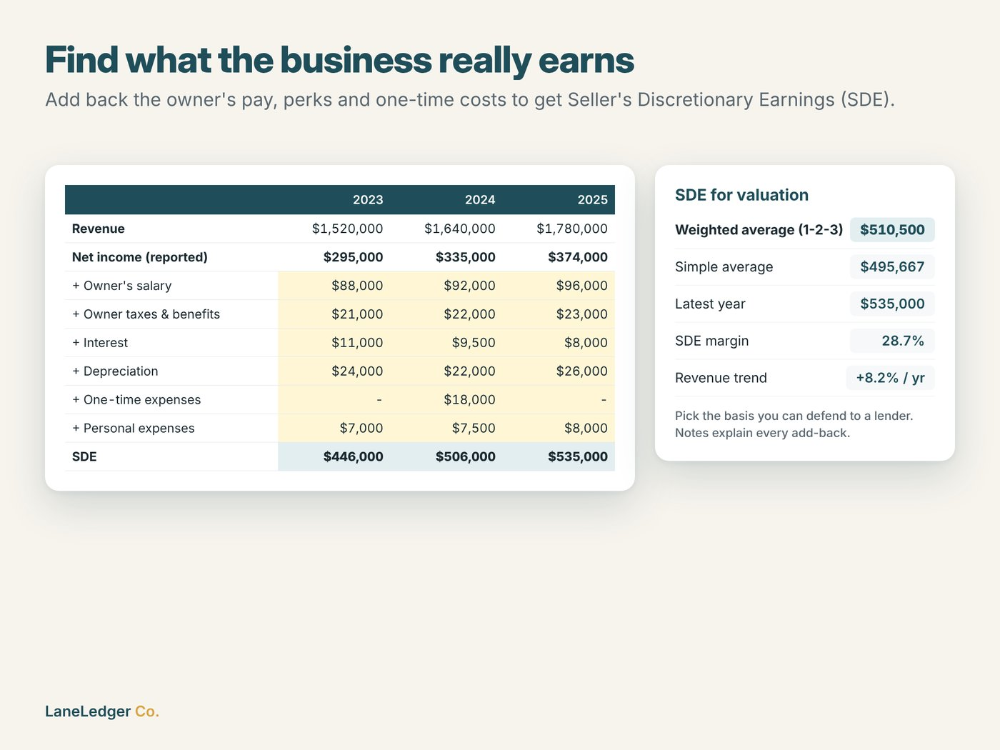
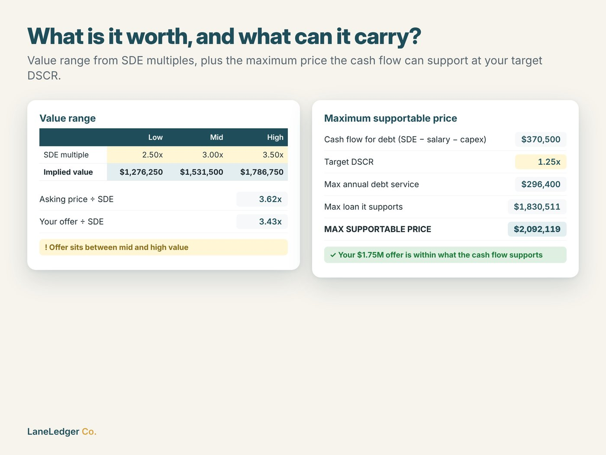
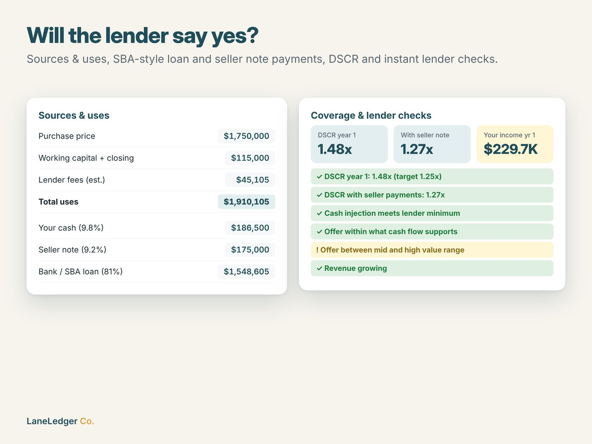
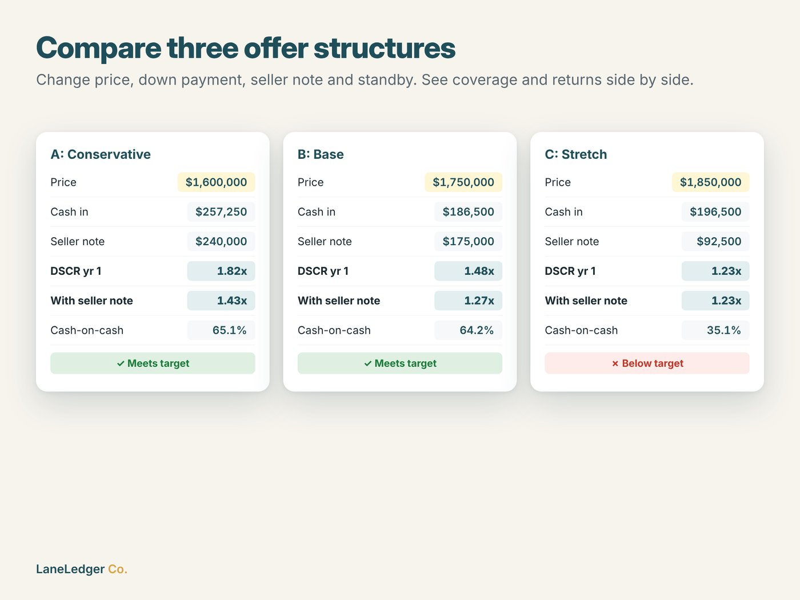
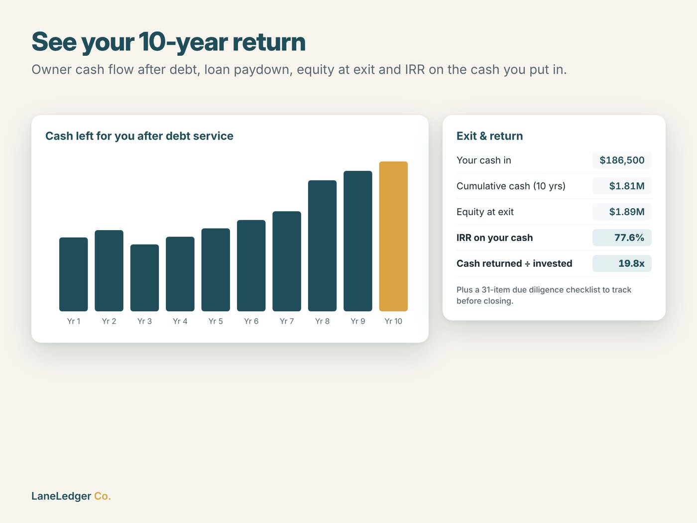

# Business Acquisition Deal Analyzer

**Should you buy this small business, and at what price?** An Excel / Google Sheets model for people buying a small business, typically with an SBA-style loan and seller financing. It turns the seller's financials into normalized earnings, a valuation range, the maximum price the cash flow can support, lender coverage checks and a 10-year return on your cash.

**[View on Etsy](https://www.etsy.com/listing/4602388755/business-acquisition-analyzer-buy-a)** · **[Download the free demo](demo/Business_Acquisition_Analyzer_FREE_DEMO.xlsx?raw=1)** · Part of [LaneLedger Co.](https://github.com/EkremHakanSevil/laneledger-spreadsheet-tools)

## The problem

Buying an existing business is one of the biggest financial decisions a person makes, and the analysis is hard: reported profit hides the owner's pay and perks, asking prices are set by sellers, and lenders decide on debt service coverage, not on the asking price. Free online calculators handle a single scenario; full models usually require a CPA or an advisor.

## What it does

| Tab | What you get |
|---|---|
| **Deal Inputs** | Asking price, your offer, working capital, closing costs, lender fees, cash injection, seller note (rate, term, standby), loan rate & term, target DSCR, your market salary, capex reserve |
| **SDE Normalization** | 3 years of revenue and costs, owner add-backs (salary, benefits, interest, D&A, one-time, personal) and deductions → SDE per year, weighted / simple / latest basis, revenue trend |
| **Valuation** | Value range from SDE multiples, asking and offer multiples, and the **maximum price the cash flow can support** at your target DSCR (closed-form, including fees and seller note) |
| **Financing** | Sources & uses, amortized loan and seller note payments, DSCR in year 1 and once seller payments start, owner income, cash-on-cash, payback, and instant ✓ / ! / ✗ lender checks |
| **Offer Scenarios** | Three offer structures side by side (price, cash in, seller note, standby, rates) with coverage and returns |
| **10-Year Projection** | Revenue & SDE growth, salary escalation, debt service by year, loan balances, cash left for the owner, equity at exit, **IRR** and cash multiple |
| **Deal Summary** | One printable page with key numbers, all checks and an automatic verdict |
| **Due Diligence** | 31-item checklist (financial, customers, operations, legal, deal & lender) with status tracking |

| SDE normalization | Valuation & max price | Lender checks |
|---|---|---|
|  |  |  |

| Offer scenarios | 10-year return |
|---|---|
|  |  |

## 🎁 Free demo

[`Business_Acquisition_Analyzer_FREE_DEMO.xlsx`](demo/Business_Acquisition_Analyzer_FREE_DEMO.xlsx?raw=1) includes Deal Inputs, SDE Normalization and Valuation, including the maximum supportable price. The full version adds Financing, Offer Scenarios, the 10-Year Projection, the Deal Summary and the Due Diligence checklist.

## How it was built

| Area | Details |
|---|---|
| Research | Pain-point and competition research: small business ownership transfer wave, few serious acquisition tools on Etsy, high willingness to pay for finance models |
| Modelling | Loan math with `PMT` / `PV`, closed-form maximum price from target DSCR, seller note standby schedule, `IRR` on equity cash flows |
| Generation | Python + `openpyxl`: the workbook is generated from code with styling, dropdown validation, conditional pass / warn / fail flags, charts and print setup |
| Testing | Headless LibreOffice recalculation (zero formula errors) plus hand-checked loan payment, fees, DSCR, maximum price and scenario cases |
| Images | HTML/CSS templates rendered to 2000×1500 listing images with Playwright |

**AI-assisted:** Built in collaboration with Anthropic's Claude. I chose the problem and positioning, reviewed and tested the model and run the Etsy listing; Claude helped with research, modelling, code generation, design and copywriting.

> This is an analysis tool, not financial, legal, tax or lending advice. Lender requirements, SBA rules, fees and rates vary and change.

---
*Screenshots, documentation and a free demo only. The full workbook is sold on Etsy.*
